# Robust Control and Energy-Efficient Trajectory Planning of a 3R Planar Robotic Arm

**A redundant three-link arm with friction: Lagrangian modelling, redundancy-resolving inverse kinematics, optimisation-based (minimum-energy and minimum-time) trajectory planning, and a robustness comparison of PID, computed-torque and sliding-mode control under payload changes, parameter errors and disturbances.**

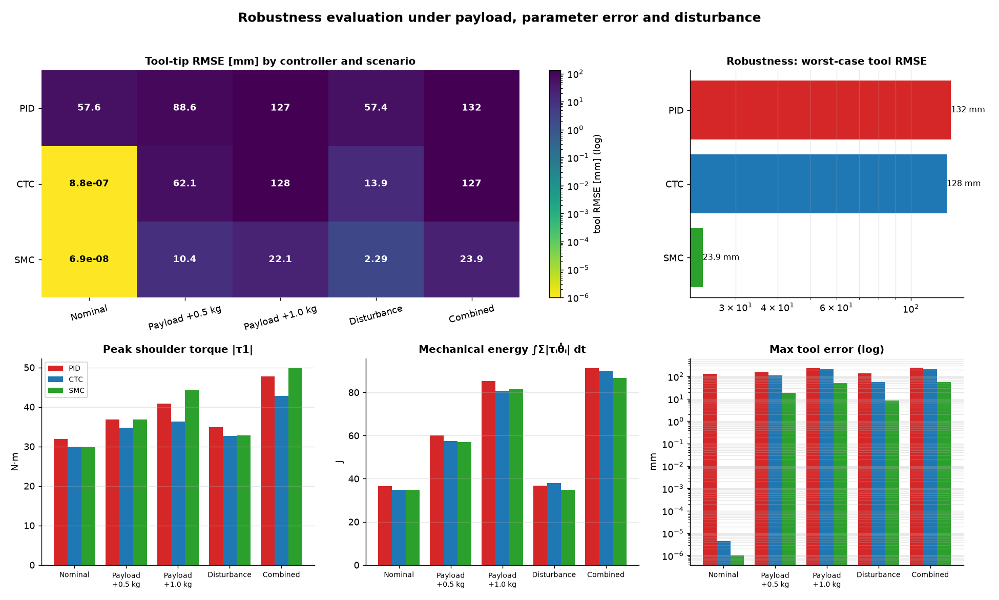

| | |
|---|---|
| **Type** | Independent project · robot dynamics, trajectory optimisation and robust control |
| **Author** | Mehdi Hasan, Mechanical Engineering, Islamic University of Technology (IUT) |
| **Year** | 2026 |
| **Tools** | Python 3.12 · NumPy · SciPy (`solve_ivp`, SLSQP) · SymPy · Matplotlib · pytest |
| **Robot** | l = (1.0, 0.8, 0.6) m, m = (1.0, 0.8, 0.5) kg, slender rods, viscous friction b = (0.25, 0.20, 0.15) N·m·s/rad, optional Coulomb friction, mounted on a table at y = 0 |
| **Verification** | **27/27 automated tests pass**: SymPy re-derivation, energy balance with friction, skew-symmetry of Ṁ − 2C, finite-difference Jacobians, analytic CTC error decay |
| **Companion project** | [2R arm: modelling and computed-torque control](https://github.com/mehdihasan261098-bot/2r-robotic-arm-control) |

### Key results

| Result | Value |
|---|---|
| Worst-case tool error across 5 scenarios: PID / CTC / **SMC** | 132 / 128 / **23.9 mm** (SMC ≈ 5× more robust at the same torque) |
| Disturbance rejection, tool RMSE: PID / CTC / **SMC** | 57.4 / 13.9 / **2.29 mm** |
| Minimum-energy trajectory vs quintic | **−51 %** ∫τᵀτ dt (1066.6 → 522.9); saving persists in closed loop (−34 to −45 %) |
| Minimum-time trajectory | **0.847 s** vs 3.0 s (3.5× faster), torque- and speed-limited |
| Chattering: ideal `sign` SMC vs boundary-layer `sat` | torque variation 86 081 vs 106 N·m/s (800× smoother) |
| Model checks | SymPy agreement ≈ 10⁻¹⁵; energy balance with friction closes to 3.5 × 10⁻⁷ relative |

Every number in this README was regenerated from the code (`python main.py --case all` plus the sensitivity sweeps) and matches [`results/metrics.md`](results/metrics.md).

---

## Contents

1. [Introduction](#1-introduction)
2. [Literature review](#2-literature-review)
3. [Robot model](#3-robot-model)
4. [Inverse kinematics of a redundant arm](#4-inverse-kinematics-of-a-redundant-arm)
5. [Optimisation-based trajectory planning](#5-optimisation-based-trajectory-planning)
6. [Controllers](#6-controllers)
7. [Test scenarios and simulation](#7-test-scenarios-and-simulation)
8. [Results](#8-results)
9. [Discussion](#9-discussion)
10. [Applications and impact](#10-applications-and-impact)
11. [Limitations and future work](#11-limitations-and-future-work)
12. [How to run](#12-how-to-run)
13. [Repository contents](#13-repository-contents)
14. [References](#14-references)

Full step-by-step derivations, each with an "In plain English" note: **[docs/THEORY.md](docs/THEORY.md)**.

---

## 1. Introduction

Real robots rarely know their own dynamics exactly. They pick up tools and parts of unknown mass, their friction drifts with temperature and wear, and they are pushed by contact forces and cable drag. A controller that is perfect on paper can fail badly when the model is wrong, as the companion 2R study showed for computed-torque control.

This project asks three linked questions on a **redundant** 3-link arm (three joints, but only two position coordinates to control):

1. **Which posture?** Infinitely many joint configurations reach the same point. How should one be chosen, while respecting joint limits and keeping the arm off the table?
2. **Which motion?** Can trajectory optimisation reduce energy use or motion time, and does the saving survive in closed loop?
3. **Which controller?** How do PID, computed-torque control (CTC) and sliding-mode control (SMC) compare when the payload, the parameters and external disturbances are all uncertain?

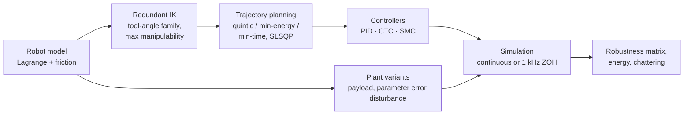

---

## 2. Literature review

| Work | Contribution | Used here for |
|---|---|---|
| Yoshikawa, 1985 [1] | Manipulability w = √det(JJᵀ) as a measure of dexterity and distance to singularity | Redundancy-resolution criterion |
| Nakamura, Hanafusa & Yoshikawa, 1987 [2] | Task-priority redundancy control using the Jacobian null space | Numerical IK with null-space manipulability ascent |
| Wampler, 1986; Nakamura & Hanafusa, 1986 [3, 4] | Damped least-squares (singularity-robust) inverse | All Jacobian inverses near singularities |
| Bobrow, Dubowsky & Gibson, 1985; Shin & McKay, 1985 [5, 6] | Time-optimal motion along a path under torque limits: solutions ride the torque limits | Expected structure of the minimum-time plan |
| Flash & Hogan, 1985 [7] | Minimum-jerk (quintic) profiles | Baseline trajectory |
| Luh, Walker & Paul, 1980 [8] | Efficient inverse dynamics for computed-torque control | CTC inner loop |
| Utkin, 1977 [9] | Variable-structure systems with sliding modes: invariance to matched uncertainty | SMC theory |
| Slotine, 1985 [10] | Sliding-mode control of manipulators with a boundary layer to remove chattering | SMC design and boundary layer |
| Slotine & Li, 1987 [11] | Reference-velocity formulation using skew-symmetry of Ṁ − 2C | The SMC law used here and its Lyapunov proof |
| Levant, 1993 [12] | Higher-order (super-twisting) sliding modes | Future work |
| Armstrong-Hélouvry, Dupont & Canudas de Wit, 1994 [13] | Survey of friction models and compensation | Viscous + smoothed Coulomb friction model |
| Khatib, 1987 [14] | Operational-space (task-space) control | Future work |
| Textbooks [15–17] | Manipulator kinematics, dynamics and control | Notation and derivations |

**Gap addressed.** Studies usually treat redundancy resolution, trajectory optimisation and robust control separately. Here they are combined on one arm, and the interaction is made visible: an energy-optimal path that skims the table becomes **unsafe** if the controller's tracking error is larger than the planned clearance.

---

## 3. Robot model

**Forward kinematics** with θ₁₂ = θ₁ + θ₂ and θ₁₂₃ = θ₁ + θ₂ + θ₃:

$$x = l_1c_1 + l_2c_{12} + l_3c_{123},\qquad y = l_1s_1 + l_2s_{12} + l_3s_{123},\qquad \phi = \theta_{123}$$

**Singularities.** For the full pose task det J = l₁l₂ sin θ₂. For the position-only task the manipulability

$$w = \sqrt{(l_1l_2s_2 + l_1l_3s_{23})^2 + (l_1l_3s_{23} + l_2l_3s_3)^2 + (l_2l_3s_3)^2}$$

vanishes only when all three links are collinear.

**Dynamics** (Lagrange's equations with friction):

$$\mathbf M(\boldsymbol\theta)\ddot{\boldsymbol\theta} + \mathbf C(\boldsymbol\theta,\dot{\boldsymbol\theta})\dot{\boldsymbol\theta} + \mathbf G(\boldsymbol\theta) + \mathbf F(\dot{\boldsymbol\theta}) = \boldsymbol\tau + \boldsymbol\tau_d$$

$$
\mathbf M = \begin{bmatrix}
a_1 + 2b_1c_2 + 2b_2c_{23} + 2b_3c_3 & a_2 + b_1c_2 + b_2c_{23} + 2b_3c_3 & a_3 + b_2c_{23} + b_3c_3\\
\cdot & a_2 + 2b_3c_3 & a_3 + b_3c_3\\
\cdot & \cdot & a_3
\end{bmatrix},\quad
\mathbf G = \begin{bmatrix}\gamma_1c_1 + \gamma_2c_{12} + \gamma_3c_{123}\\ \gamma_2c_{12} + \gamma_3c_{123}\\ \gamma_3c_{123}\end{bmatrix}
$$

$$\mathbf F = \mathbf B\dot{\boldsymbol\theta} + \mathbf F_c\tanh(\dot{\boldsymbol\theta}/\varepsilon)$$

Constants: a = (2.184, 0.5507, 0.06), b = (0.72, 0.15, 0.12) kg·m², γ = (17.66, 7.06, 1.47) N·m. The shoulder carries up to 26.2 N·m of gravity load; C is built from Christoffel symbols (explicit 3 × 3 form in [THEORY Part 5](docs/THEORY.md), §5.6). A payload is modelled as a point mass at the tool that changes the link-3 mass, COM and inertia ([THEORY §5.10](docs/THEORY.md#510-modelling-a-payload)).

| Verification | Result |
|---|---|
| SymPy vs closed form | max \|ΔM\| = 8.9 × 10⁻¹⁶, \|ΔC\| = 1.8 × 10⁻¹⁵, \|ΔG\| = 3.6 × 10⁻¹⁵ |
| Passive swing with friction: energy lost vs friction dissipation | 26.5872 J vs 26.5872 J, residual 9.3 × 10⁻⁶ J |
| Test suite | 27/27 pass |

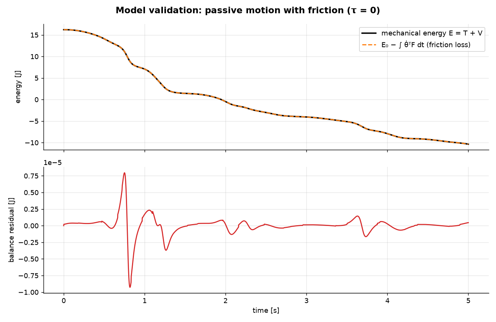

*Passive motion with friction: mechanical energy (solid) and the cumulative friction loss (dashed) overlap; the residual stays below 10⁻⁵ J.*

---

## 4. Inverse kinematics of a redundant arm

A position-only target gives 2 equations in 3 unknowns, so every reachable point has a **one-parameter family** of solutions (the self-motion). The method (THEORY Part 4):

1. **Parameterise the redundancy by the tool angle φ.** The wrist must sit at $\mathbf p_w = \mathbf p - l_3[\cos\phi,\ \sin\phi]$.
2. **Solve the 2R sub-problem** for θ₁, θ₂ in closed form (elbow-up or elbow-down), then θ₃ = φ − θ₁ − θ₂.
3. **Keep only admissible φ:** wrist reachable, joint limits respected, elbow and wrist ≥ 0.1 m above the table, tool above the table.
4. **Choose φ that maximises manipulability**, with an optional continuity penalty between via points. Search: 0.5° grid, then bounded Brent refinement.

**Cross-check with a numerical method** (DLS inverse plus null-space manipulability ascent, $\Delta\boldsymbol\theta = \mathbf J_p^{\#}\mathbf e + (\mathbf I - \mathbf J_p^{\#}\mathbf J_p)k\nabla w$):

| Target [m] | Geometric IK q [°] | φ [°] | w | Numerical IK q [°] | w | Numerical admissible? |
|---|---|---|---|---|---|---|
| (1.6, 0.6) | (69.9, −66.5, −43.7) | −40.2 | 1.610 | (69.9, −66.5, −43.6) | 1.610 | yes |
| (−1.2, 0.9) | (174.3, −26.6, −109.3) | 38.3 | 1.250 | (200.8, −78.7, −47.7) | 1.561 | **no**: elbow below the table |

At the start both methods find the same optimum. At the goal, the unconstrained gradient method reaches a higher manipulability by pushing the elbow **through the table**. The geometric method enumerates the whole self-motion family, so it enforces such constraints exactly, which is why it is the primary method.

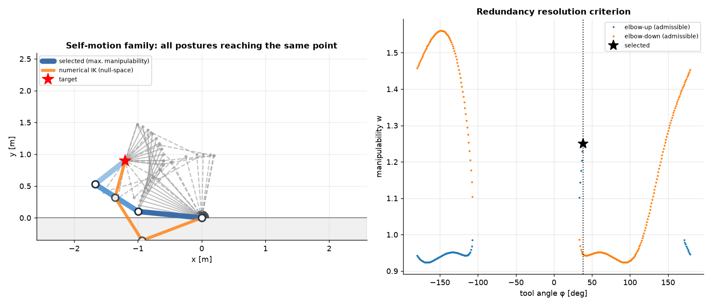

*Left: the self-motion family of postures reaching the same point. Right: manipulability vs tool angle for both elbow branches; the star marks the selected posture.*

---

## 5. Optimisation-based trajectory planning

The joint trajectory is a quintic plus a correction that vanishes, with its first two derivatives, at both ends:

$$\boldsymbol\theta(s) = \boldsymbol\theta_{\text{quintic}}(s) + \sum_{k=1}^{5}\mathbf c_k\,s^3(1-s)^3P_{k-1}(2s - 1),\qquad s = t/T$$

where $P_k$ are Legendre polynomials. Boundary conditions are therefore satisfied by construction.

| | Minimum energy | Minimum time |
|---|---|---|
| Decision variables | 15 coefficients **c**ₖ | 15 coefficients + duration T |
| Cost | $\int_0^T\boldsymbol\tau^\top\boldsymbol\tau\,dt$ (∝ motor copper loss), τ from nominal inverse dynamics with friction | T + 10⁻³ × normalised energy |
| Constraints (81 collocation points) | \|τᵢ\| ≤ (60, 30, 10) N·m, \|θ̇ᵢ\| ≤ 3 rad/s, joint limits, elbow/wrist/tool ≥ 0.02 m above the table | same |
| Solver | SLSQP from the quintic (312 iterations, 2.6 s) | SLSQP (98 iterations, 1.1 s) |

**Results** (move from (1.6, 0.6) to (−1.2, 0.9) m):

| Trajectory | T [s] | ∫τᵀτ dt | Mech. work [J] | Peak τ₁/τ₂/τ₃ [N·m] | Peak speed [rad/s] | Min height [m] | Min manipulability |
|---|---|---|---|---|---|---|---|
| Quintic | 3.000 | 1066.6 | 28.27 | 25.5 / 9.6 / 1.17 | 1.14 | 0.100 | 1.25 |
| **Min-energy** | 3.000 | **522.9 (−51 %)** | 34.93 (+24 %) | 29.9 / 9.0 / 1.90 | 3.00 (limit) | 0.020 (limit) | 0.42 |
| **Min-time** | **0.847** | 1649.3 | 78.07 | 60.2 (limit) / 27.6 / 4.84 | 3.00 (limit) | 0.100 | 1.06 |

- **Minimum energy** halves copper-loss energy by **folding the arm** early (θ₂ ≈ −165°) to shorten the gravity lever arms, then unfolding at the end. The price: more mechanical work, operation at the speed limit, a path that skims the table at the 2 cm margin, and lower manipulability.
- **Minimum time** is 3.5× faster and rides the shoulder torque limit (60 N·m) and the speed limit, the classical structure of a time-optimal solution.

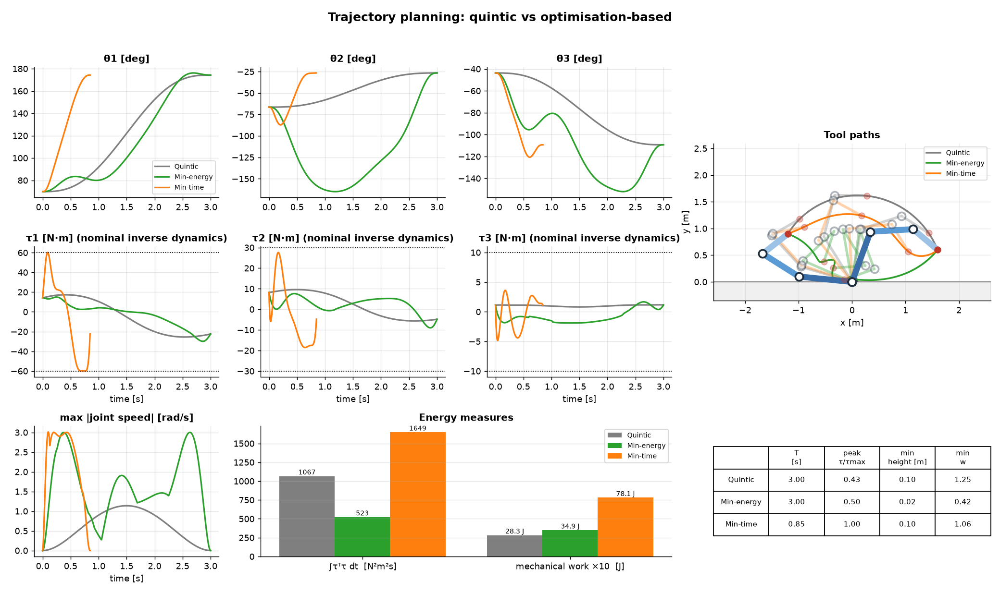

---

## 6. Controllers

With $\mathbf e = \boldsymbol\theta_d - \boldsymbol\theta$:

| Controller | Law | Gains |
|---|---|---|
| **PID** | $\boldsymbol\tau = \mathbf K_p\mathbf e + \mathbf K_i\int\mathbf e + \mathbf K_d\dot{\mathbf e}$ | Kₚ = (400, 200, 40), Kᵢ = (200, 100, 20), K_d = (60, 25, 4); anti-windup \|∫e\| ≤ 1 |
| **CTC** with friction compensation | $\boldsymbol\tau = \hat{\mathbf M}(\ddot{\boldsymbol\theta}_d + \mathbf K_d\dot{\mathbf e} + \mathbf K_p\mathbf e) + \hat{\mathbf C}\dot{\boldsymbol\theta} + \hat{\mathbf G} + \hat{\mathbf F}$ | ωₙ = 20 rad/s, ζ = 1 (Kₚ = 400, K_d = 40) |
| **SMC** (Slotine–Li) | $\mathbf s = \dot{\mathbf e} + \boldsymbol\Lambda\mathbf e$, $\ \boldsymbol\tau = \hat{\mathbf M}\ddot{\boldsymbol\theta}_r + \hat{\mathbf C}\dot{\boldsymbol\theta}_r + \hat{\mathbf G} + \hat{\mathbf F} + \mathbf K_D\mathbf s + \mathbf K\,\mathrm{sat}(\mathbf s/\boldsymbol\Phi)$ | Λ = 10, K_D = (20, 8, 1), K = (35, 18, 7) N·m, Φ = (0.2, 0.3, 0.5) rad/s |

**Why SMC is robust.** The sliding variable **s** combines position and velocity error. The switching term K·sat(s/Φ) is a *bounded* correction sized from physical uncertainty bounds: K roughly matches the worst-case gravity torque of a 1 kg payload (9.81 · mₚ · lever arm = 23.5 / 13.7 / 5.9 N·m) plus the disturbance amplitude. Using the skew-symmetry of Ṁ − 2C, a Lyapunov argument (THEORY §7.3) drives **s** into the boundary layer, where the tracking error is bounded by about Φ/λ regardless of how the uncertainty is distributed. The boundary layer replaces the discontinuous `sign` function to prevent chattering.

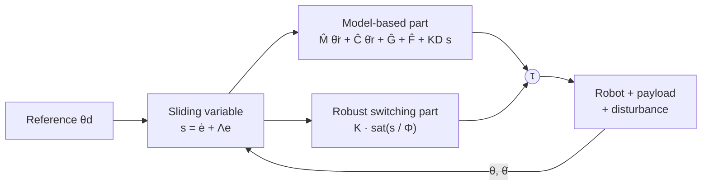

---

## 7. Test scenarios and simulation

Every controller is built on the **nominal** model; each scenario changes only the simulated plant.

| Scenario | What changes in the real robot |
|---|---|
| Nominal | Nothing (plant = model) |
| Payload +0.5 kg | 0.5 kg point mass at the tool |
| Payload +1.0 kg | 1.0 kg point mass at the tool (doubles distal mass) |
| Disturbance | Sinusoidal joint torques (3 / 1.5 / 0.5 N·m at 0.8 / 1.3 / 2.0 Hz) plus three smooth pushes: 8 N·m on joint 1 and −4 N·m on joint 2 during the move, 2 N·m on joint 3 during the hold |
| **Combined** | 1 kg payload, masses +10 %, friction +50 %, plus the disturbance |

**Simulation:** SciPy `solve_ivp` (RK45, rtol = 10⁻⁷), either continuous-time or **sampled-data at 1 kHz with zero-order hold** (needed to see real chattering). Reference: the minimum-energy trajectory over 3 s, then a 1 s hold. The plant and the controller's model are separate objects; the PID integral is part of the ODE state so adaptive integration stays correct.

---

## 8. Results

### 8.1 Robustness matrix (tool-tip RMSE, mm)

| Controller | Nominal | Payload +0.5 kg | Payload +1.0 kg | Disturbance | Combined | Mean | Worst |
|---|---|---|---|---|---|---|---|
| PID | 57.6 | 88.6 | 127 | 57.4 | 132 | 92.5 | 132 |
| CTC | 8.8 × 10⁻⁷ | 62.1 | 128 | 13.9 | 127 | 66.2 | 128 |
| **SMC** | 6.9 × 10⁻⁸ | **10.4** | **22.1** | **2.29** | **23.9** | **11.8** | **23.9** |

**Lowest point reached by elbow, wrist or tool [mm]** (table at 0; plan keeps ≥ 20 mm; negative = arm hits the table):

| Controller | Nominal | Payload +0.5 kg | Payload +1.0 kg | Disturbance | Combined |
|---|---|---|---|---|---|
| PID | 8 | **−31** | **−76** | 7 | **−80** |
| CTC | 20 | **−53** | **−128** | 25 | **−132** |
| SMC | 20 | 9 | −2 | 20 | −2 |

Torque and energy are similar for all three (Combined: peak τ₁ = 47.8 / 42.8 / 49.8 N·m; mechanical energy 91.2 / 90.0 / 86.8 J). **SMC's 5× better accuracy does not come from spending more torque**, but from where the corrective torque is applied.

| 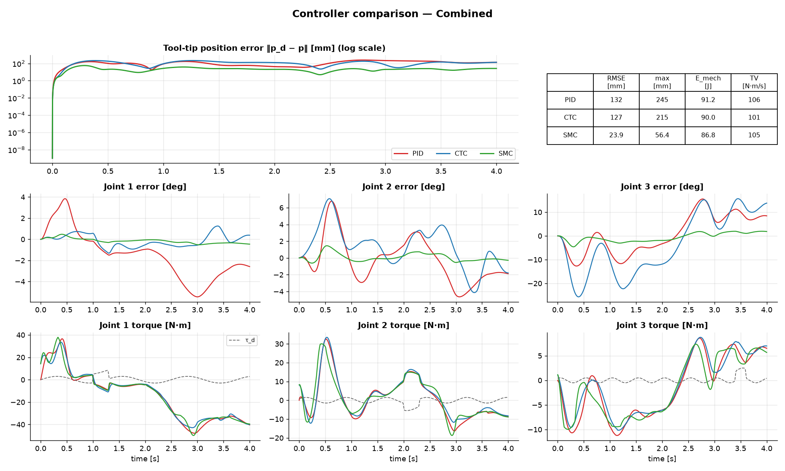 | 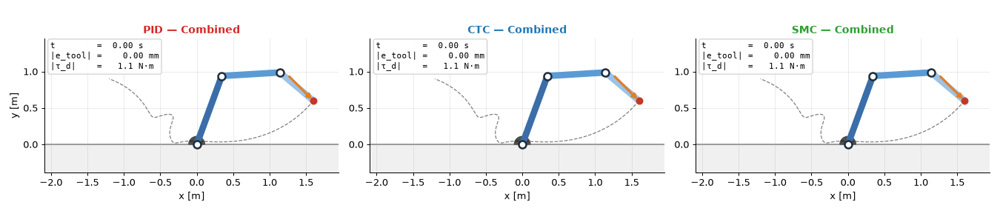 |
|---|---|
| Combined scenario: tool error (log scale), joint errors and torques | PID, CTC and SMC side by side under the combined uncertainty |

| 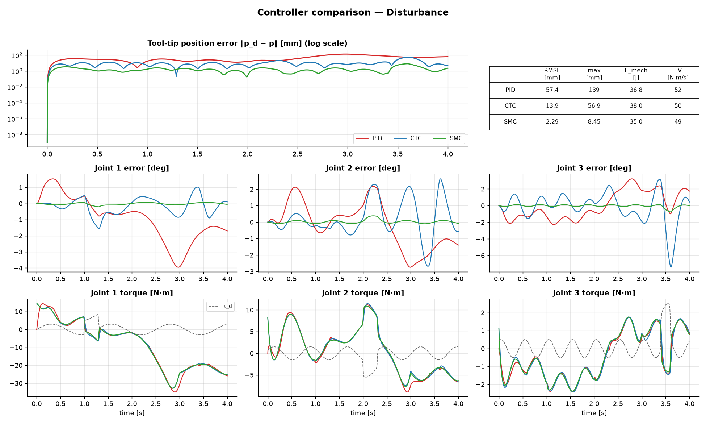 | 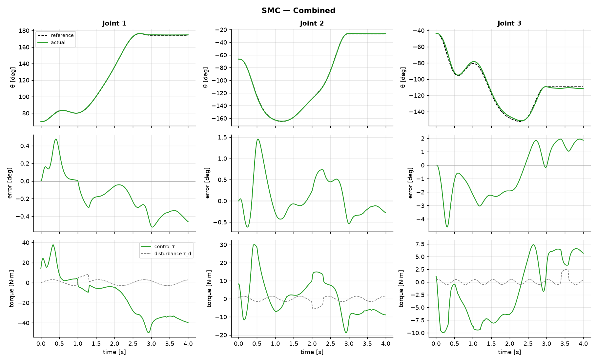 |
|---|---|
| Disturbance rejection | SMC tracking in the combined scenario |

### 8.2 Sensitivity studies

**CTC bandwidth** (tool RMSE, mm):

| ωₙ [rad/s] | Payload +1.0 kg | Disturbance | Combined | Peak τ₁, Combined [N·m] |
|---|---|---|---|---|
| 10 | 450 | 39.3 | 437 | 44.4 |
| 20 (default) | 128 | 13.9 | 127 | 42.8 |
| 40 | 32.5 | 4.07 | 33.0 | 50.7 |
| 80 | 7.85 | 1.08 | 8.00 | 51.2 |

**SMC boundary layer and switching gain** (Combined scenario):

| Φ scale | Tool RMSE [mm] | Torque TV [N·m/s] | | K scale | Tool RMSE [mm] |
|---|---|---|---|---|---|
| 0.25 | 9.58 | 106 | | 0 (no switching term) | 270 |
| 0.5 | 14.4 | 106 | | 0.5 | 96.6 |
| 1.0 (default) | 23.9 | 105 | | 1.0 (default) | 23.9 |
| 2.0 | 41.8 | 103 | | 1.5 | 15.2 |

### 8.3 Chattering (sampled-data at 1 kHz, Combined scenario)

| Switching function | Torque TV [N·m/s] | Power above 20 Hz | Tool RMSE [mm] | Mech. energy [J] |
|---|---|---|---|---|
| `sign` (ideal SMC) | **86 081** | **91 %** | 10.4 | **187.2** |
| `sat` (boundary layer, default) | 106 | 0.14 % | 24.0 | 86.9 |
| `tanh` | 105 | 0.14 % | 29.9 | 87.3 |
| *PID / CTC (continuous)* | *106 / 101* | *0.35 % / 0.10 %* | *132 / 127* | *91.2 / 90.0* |

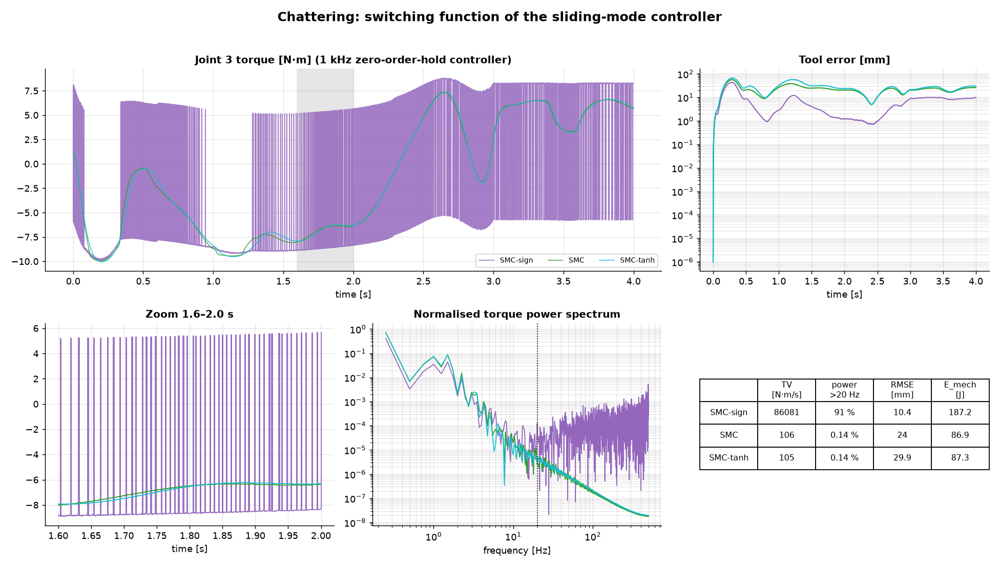

*The ideal `sign` law switches the joint-3 torque between ±7 N·m every sample; the boundary layer makes it as smooth as PID or CTC.*

### 8.4 Closed-loop energy: quintic vs minimum-energy reference

∫τᵀτ dt / mechanical work [J], 4 s including the hold:

| Controller | Nominal, quintic | Nominal, min-energy | Combined, quintic | Combined, min-energy |
|---|---|---|---|---|
| PID | 1717 / 32.1 | 1112 / 36.7 | 6007 / 72.9 | 3301 / 91.2 |
| CTC | 1592 / 28.3 | 1048 / 34.9 | 5046 / 64.0 | 3026 / 90.0 |
| SMC | 1592 / 28.3 | 1048 / 34.9 | 5268 / 57.3 | 3079 / 86.8 |

---

## 9. Discussion

**Nominal plant: model-based control is essentially exact.** CTC and SMC both cancel the dynamics and track to integrator precision (< 10⁻⁶ mm). PID's 58 mm error is the classic gravity-induced lag: the shoulder carries up to 26 N·m of gravity load, and a decentralised linear controller only reacts after an error appears.

**Payload: CTC loses its advantage.** A 1 kg payload adds up to 23.5 N·m of unmodelled gravity torque. CTC turns it into an acceleration error through $\hat{\mathbf M}^{-1}$, amplified by the light distal joint ($\hat M_{33}$ = 0.06 kg·m²), and the PD outer loop must absorb an error of size ‖η‖/ωₙ². At ωₙ = 20 CTC is no better than PID (128 vs 127 mm). The bandwidth sweep confirms the law: ≈ 4× less error per doubling of ωₙ. CTC only matches SMC at ωₙ ≈ 80 rad/s, a 16× higher Kₚ that would amplify sensor noise and push against the 1 kHz sample rate.

**Disturbance and combined uncertainty: SMC's guarantee holds.** SMC rejects the torque pulses within the boundary layer (6× better than CTC, 25× better than PID), and its error barely grows from "Payload +1 kg" to "Combined" (22.1 → 23.9 mm) even with friction, mass errors and disturbance stacked on top. The sensitivity sweeps match the theory: error ∝ Φ (ultimate bound Φ/λ), and removing the switching term (K = 0) sends the error to 270 mm, so the robust term does the work.

**Chattering is real, and the boundary layer fixes it.** Ideal `sign` switching tracks better (10.4 mm) but its torque varies 800× faster, puts 91 % of its power above 20 Hz and wastes over twice the mechanical energy, which would excite unmodelled modes and wear gearboxes. The `sat` boundary layer is as smooth as PID or CTC. The sampled-data `sat` result (24.0 mm) agrees with the continuous simulation (23.9 mm), which cross-validates the two simulation modes.

**Planning and control interact: a safety finding.** The minimum-energy plan passes only 2 cm above the table. With 100+ mm tracking errors, PID and CTC drive the arm 76–132 mm **into the table** under payload. SMC just touches it (−2 mm). Energy-optimal plans therefore need a clearance margin at least as large as the controller's worst-case error, which is known in advance for SMC (≈ Φ/λ) but not for PID or CTC.

**Conclusions**

1. The 3R model is verified independently (SymPy ≈ 10⁻¹⁵, energy balance 3.5 × 10⁻⁷ relative, 27 tests).
2. Redundancy is best resolved geometrically: exact solutions, both elbow branches, and exact constraint enforcement. The numerical null-space method is a cross-check that can violate constraints.
3. Optimisation-based planning halves copper-loss energy, and the saving persists in closed loop (−34 to −45 %), at the cost of more mechanical work and less clearance.
4. **CTC** is best with a correct model; **PID** is simple but never accurate (58–132 mm); **SMC** is the most robust (worst case 23.9 mm vs 127–132 mm) at the same torque and energy.
5. Robustness comes from bounded nonlinear correction, not high linear gain.

---

## 10. Applications and impact

| Area | Relevance |
|---|---|
| Pick-and-place and palletising | Payload varies from task to task; SMC-type robustness keeps accuracy without re-identifying the model |
| Collaborative and mobile manipulators | Unknown tools and contact disturbances; bounded, predictable tracking error |
| Energy-aware automation | Minimum-energy trajectories cut motor copper losses by half on repetitive motions |
| Cycle-time optimisation | Minimum-time planning under torque and speed limits for high-throughput cells |
| Safety-aware motion planning | Clearance margins derived from the controller's guaranteed error bound |
| Redundant manipulators | Posture selection that maximises dexterity while honouring joint limits and obstacles |

**Impact:** a verified, reproducible benchmark that ties together posture choice, motion optimisation and robust control, and shows quantitatively why robustness must be designed in, not added with higher gain.

---

## 11. Limitations and future work

**Limitations:** simulation only; rigid links; perfect state measurement (no encoder noise or quantisation); actuator dynamics and backlash not modelled; payload-scenario torques slightly exceed the limits the plan was optimised for on the nominal arm.

**Future work**

- **Adaptive control** (Slotine–Li adaptive CTC/SMC): the dynamics are linear in the parameters, so the payload can be estimated online, allowing a thinner boundary layer.
- **Higher-order / super-twisting SMC** (Levant): continuous control with finite-time convergence and no boundary-layer accuracy loss.
- **Disturbance observers** (DOB/ESO) with CTC, a common industrial alternative to SMC.
- **Robust trajectory optimisation**: clearance tubes from the SMC bound Φ/λ, joint optimisation of the final redundant posture, and a mechanical-energy cost with regenerative drives.
- **Actuator realism**: motor electrical dynamics, gear backlash, torque saturation during tracking, encoder quantisation and noise.
- **Task-space control** with null-space posture optimisation (operational-space control, Khatib).

---

## 12. How to run

```bash
python -m venv .venv
```

```bash
.venv\Scripts\activate
```

```bash
pip install -r requirements.txt
```

```bash
python -m pytest -q
```

| Command | Study | Time |
|---|---|---|
| `python main.py --case validate` | SymPy check + passive energy balance with friction | ~25 s |
| `python main.py --case ik` | Redundancy resolution; geometric vs numerical IK | ~3 s |
| `python main.py --case plan` | Quintic vs minimum-energy vs minimum-time | ~5 s |
| `python main.py --case track --controller smc --scenario Combined --animate` | One controller, one scenario, with animation | ~15 s |
| `python main.py --case compare` | PID vs CTC vs SMC, nominal and combined | ~1 min |
| `python main.py --case robust --animate` | 3 controllers × 5 scenarios, heat map, figures, GIFs | ~3–4 min |
| `python main.py --case chattering` | SMC with sign / sat / tanh switching at 1 kHz | ~30 s |
| `python main.py --case all --no-show --animate` | Everything; writes `results/metrics.md` | ~5–6 min |

Options: `--trajectory energy|quintic|time`, `--scenario Nominal|"Payload +0.5 kg"|"Payload +1.0 kg"|Disturbance|Combined`, `--no-show`, `--save-dir DIR`. Gains can be overridden in code, e.g. `make_controller("ctc", model, wn=40)` or `make_controller("smc", model, switching="tanh", phi=(0.1, 0.15, 0.25))`.

**As a library:**

```python
from robot3r import RobotArm3R, RobotParams3R, Simulator, make_controller, plan_trajectory, default_disturbance

model = RobotArm3R()                                        # nominal model
qA, qB = model.inverse_kinematics((1.6, 0.6)), model.inverse_kinematics((-1.2, 0.9))
traj = plan_trajectory(model, qA, qB, 3.0, objective="energy").trajectory

plant = RobotArm3R(RobotParams3R(payload=1.0))              # the real robot carries 1 kg
for kind in ("pid", "ctc", "smc"):
    res = Simulator(plant, make_controller(kind, model), traj, disturbance=default_disturbance()).run(4.0)
    print(kind, res.metrics()["rmse_ee"])
```

---

## 13. Repository contents

```
3r-robotic-arm-robust-control/
├── README.md
├── docs/THEORY.md              ← derivations with plain-English explanations (Parts 1–8)
├── robot3r/
│   ├── robot.py                ← RobotArm3R: FK, Jacobians, singularities, geometric + numerical IK,
│   │                              vectorised M/C/G/F, inverse/forward dynamics, energy, drawing
│   ├── trajectory.py           ← quintic and piecewise quintic, Cartesian via points, singularity scan
│   ├── optimization.py         ← min-energy / min-time planning (SLSQP), trajectory report
│   ├── controllers.py          ← PID, computed torque, sliding mode, make_controller()
│   ├── disturbances.py         ← sinusoids, smooth pulses, default disturbance
│   ├── simulation.py           ← Simulator (continuous or 1 kHz ZOH), metrics
│   ├── scenarios.py            ← the five robustness scenarios, batch runner
│   ├── visualization.py        ← planning, tracking, robustness, chattering figures; animation
│   └── symbolic.py             ← independent SymPy derivation and cross-check
├── tests/test_robot3r.py       ← 27 verification tests
├── main.py                     ← command-line interface for all studies
├── results/                    ← figures, GIF animations and metrics.md
└── requirements.txt
```

## 14. References

1. T. Yoshikawa, "Manipulability of robotic mechanisms," *Int. J. Robot. Res.*, vol. 4, pp. 3–9, 1985. doi:[10.1177/027836498500400201](https://doi.org/10.1177/027836498500400201)
2. Y. Nakamura, H. Hanafusa and T. Yoshikawa, "Task-priority based redundancy control of robot manipulators," *Int. J. Robot. Res.*, vol. 6, pp. 3–15, 1987. doi:[10.1177/027836498700600201](https://doi.org/10.1177/027836498700600201)
3. C. W. Wampler, "Manipulator inverse kinematic solutions based on vector formulations and damped least-squares methods," *IEEE Trans. Syst. Man Cybern.*, vol. 16, pp. 93–101, 1986. doi:[10.1109/TSMC.1986.289285](https://doi.org/10.1109/TSMC.1986.289285)
4. Y. Nakamura and H. Hanafusa, "Inverse kinematic solutions with singularity robustness for robot manipulator control," *J. Dyn. Syst. Meas. Control*, vol. 108, pp. 163–171, 1986. doi:[10.1115/1.3143764](https://doi.org/10.1115/1.3143764)
5. J. E. Bobrow, S. Dubowsky and J. S. Gibson, "Time-optimal control of robotic manipulators along specified paths," *Int. J. Robot. Res.*, vol. 4, pp. 3–17, 1985. doi:[10.1177/027836498500400301](https://doi.org/10.1177/027836498500400301)
6. K. G. Shin and N. D. McKay, "Minimum-time control of robotic manipulators with geometric path constraints," *IEEE Trans. Autom. Control*, vol. 30, pp. 531–541, 1985. doi:[10.1109/TAC.1985.1104009](https://doi.org/10.1109/TAC.1985.1104009)
7. T. Flash and N. Hogan, "The coordination of arm movements: an experimentally confirmed mathematical model," *J. Neurosci.*, vol. 5, pp. 1688–1703, 1985. doi:[10.1523/JNEUROSCI.05-07-01688.1985](https://doi.org/10.1523/JNEUROSCI.05-07-01688.1985)
8. J. Y. S. Luh, M. W. Walker and R. P. C. Paul, "On-line computational scheme for mechanical manipulators," *J. Dyn. Syst. Meas. Control*, vol. 102, pp. 69–76, 1980. doi:[10.1115/1.3149599](https://doi.org/10.1115/1.3149599)
9. V. Utkin, "Variable structure systems with sliding modes," *IEEE Trans. Autom. Control*, vol. 22, pp. 212–222, 1977. doi:[10.1109/TAC.1977.1101446](https://doi.org/10.1109/TAC.1977.1101446)
10. J.-J. E. Slotine, "The robust control of robot manipulators," *Int. J. Robot. Res.*, vol. 4, pp. 49–64, 1985. doi:[10.1177/027836498500400205](https://doi.org/10.1177/027836498500400205)
11. J.-J. E. Slotine and W. Li, "On the adaptive control of robot manipulators," *Int. J. Robot. Res.*, vol. 6, pp. 49–59, 1987. doi:[10.1177/027836498700600303](https://doi.org/10.1177/027836498700600303)
12. A. Levant, "Sliding order and sliding accuracy in sliding mode control," *Int. J. Control*, vol. 58, pp. 1247–1263, 1993. doi:[10.1080/00207179308923053](https://doi.org/10.1080/00207179308923053)
13. B. Armstrong-Hélouvry, P. Dupont and C. Canudas de Wit, "A survey of models, analysis tools and compensation methods for the control of machines with friction," *Automatica*, vol. 30, pp. 1083–1138, 1994. doi:[10.1016/0005-1098(94)90209-7](https://doi.org/10.1016/0005-1098(94)90209-7)
14. O. Khatib, "A unified approach for motion and force control of robot manipulators: the operational space formulation," *IEEE J. Robot. Autom.*, vol. 3, pp. 43–53, 1987. doi:[10.1109/JRA.1987.1087068](https://doi.org/10.1109/JRA.1987.1087068)
15. M. W. Spong, S. Hutchinson and M. Vidyasagar, *Robot Modeling and Control*, 2nd ed. Wiley, 2020.
16. B. Siciliano, L. Sciavicco, L. Villani and G. Oriolo, *Robotics: Modelling, Planning and Control*. Springer, 2009. doi:[10.1007/978-1-84628-642-1](https://doi.org/10.1007/978-1-84628-642-1)
17. J.-J. E. Slotine and W. Li, *Applied Nonlinear Control*. Prentice Hall, 1991.
18. P. Virtanen *et al.*, "SciPy 1.0: fundamental algorithms for scientific computing in Python," *Nat. Methods*, vol. 17, pp. 261–272, 2020. doi:[10.1038/s41592-019-0686-2](https://doi.org/10.1038/s41592-019-0686-2)
19. D. Kraft, *A Software Package for Sequential Quadratic Programming*, DFVLR-FB 88-28, 1988 (the SLSQP algorithm).

---

<sub>© 2026 Mehdi Hasan · [Portfolio](https://mehdi-hasan.netlify.app) · [LinkedIn](https://www.linkedin.com/in/mehdi-hasan-868639245) · [GitHub](https://github.com/mehdihasan261098-bot)</sub>
